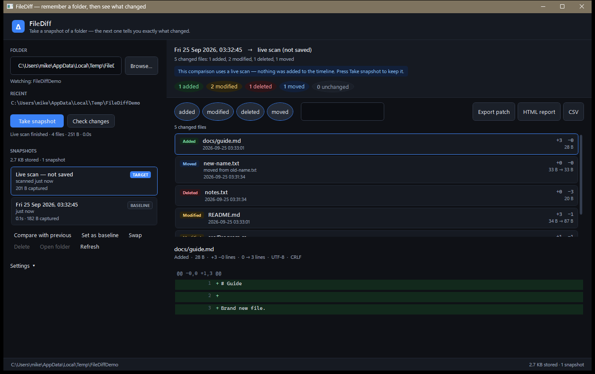

# FileDiff

A Windows desktop app that **remembers the state of a folder** and shows you exactly what changed
the next time you point it at that folder.

Point it at a path and press **Take snapshot**. Do some work. Press **Take snapshot** again (or
**Check changes** to look without saving) and the app reports every file that was added, modified,
deleted or moved — with a real line-by-line diff for text files, not just "size changed".



---

## What it does

| | |
|---|---|
| **Remembers state** | Each snapshot stores every file's path, size, timestamp, SHA-256 and (for text) its content. |
| **Shows real differences** | Added / modified / deleted / **moved**, with line-level diffs and inline highlighting of the part of a line that actually changed. |
| **Compares any two snapshots** | Not just "last time" — pick any two points in the timeline. |
| **Live check** | *Check changes* scans and compares without writing anything to the timeline. |
| **Exports** | Git-compatible `.patch`, a self-contained HTML report, or CSV. |
| **Stays out of the way** | The watched folder is opened read-only. Everything is stored in `%APPDATA%\FileDiff`. |
| **Is fast on big folders** | Unchanged files are not re-read; identical content is stored only once, ever. |

## How it works

```
   folder on disk                    %APPDATA%\FileDiff
┌──────────────────┐          ┌───────────────────────────────────────┐
│ scan folder      │          │ projects\<projectKey>\                │
│  ├ ignore rules  │─────────▶│   project.json                        │
│  ├ SHA-256 each  │  save    │   index.json      (snapshot timeline) │
│  └ brotli store  │          │   blobs\aa\bb\<sha256>.br  (content) │
└──────────────────┘          │   snapshots\<id>\manifest.json       │
          │                   └───────────────────────────────────────┘
          └─ compare two manifests ─▶ added / modified / deleted / moved
                                        └─ per file: line diff
```

Three ideas do most of the work:

1. **Content-addressed storage.** A file's bytes are stored under the name of their own SHA-256
   hash, Brotli-compressed. The same content is therefore written *once* no matter how many files
   contain it or how many snapshots reference it — and a rename is detected for free, because the
   hash does not change when a file moves.

2. **A fast path that skips untouched files.** A file whose size and timestamp match the previous
   snapshot keeps its previous hash without being read at all, so re-scanning a large folder is
   close to free.

3. **Content-based comparison.** Nothing is reported as changed just because a timestamp moved. A
   file that was rewritten with identical bytes is counted separately as "unchanged content".

## Getting started

Requires the [.NET 10 SDK](https://dotnet.microsoft.com/download) on Windows.

```powershell
# build everything
dotnet build FileDiff.slnx

# run the app
dotnet run --project src/FileDiff.App

# run the tests
dotnet test
```

## Making it a desktop app

FileDiff is already a native Windows desktop application (WPF): a real window with its own
process, icon, task-bar entry and `Alt+Tab` presence. `dotnet run` is only a convenient way to
*start* it while developing — you can also produce a normal `.exe` you double-click.

```powershell
# small build (~0.5 MB) — needs the .NET 10 Desktop Runtime on the machine
dotnet publish src/FileDiff.App -c Release -r win-x64 --self-contained false -o publish\FileDiff

# standalone build (~134 MB, one file) — runs on any Windows 10/11 machine, nothing to install
dotnet publish src/FileDiff.App -c Release -r win-x64 --self-contained true `
    -p:PublishSingleFile=true -p:IncludeNativeLibrariesForSelfExtract=true -o publish\FileDiff-standalone
```

To install it like a normal program (Start Menu + Desktop shortcut, no admin rights needed):

```powershell
.\Install-FileDiff.ps1                      # standalone build
.\Install-FileDiff.ps1 -Variant Light       # small build
.\Install-FileDiff.ps1 -NoDesktop           # Start Menu entry only
```

That copies the app to `%LOCALAPPDATA%\Programs\FileDiff` and drops `Uninstall FileDiff.ps1`
next to it, which removes both the app and its shortcuts (your snapshot history in
`%APPDATA%\FileDiff` is deliberately left alone).


## Project layout

```
FileDiff.slnx
├─ src/FileDiff.Core          net10.0        the engine — no UI, no third-party packages
│   ├─ Models/                               FileEntry, ScanManifest, SnapshotSummary
│   ├─ Scanning/                             Scanner, GlobMatcher, FileClassifier
│   ├─ Storage/                              SnapshotStore, BlobStore, SnapshotService
│   ├─ Diffing/                              DiffEngine, LineDiffer, TextDecoder
│   ├─ Export/                               patch, HTML, CSV
│   └─ Util/                                 paths, helpers, logging
├─ src/FileDiff.App           net10.0-windows WPF UI (MVVM, hand-rolled view model)
└─ tests/FileDiff.Core.Tests                 xUnit, including property tests for the differ
```

The engine has **zero NuGet dependencies** — `System.Text.Json` and Brotli are in the framework.
The UI has no MVVM package either, so `dotnet restore` pulls nothing but the test packages.

## The diff algorithm

`LineDiffer` is the piece most likely to be subtly wrong, so it gets the most care:

* Myers' O(ND) shortest-edit-script search, with common leading/trailing lines stripped first.
* The search trace keeps only the band each iteration touched, so memory is bounded by the edit
  distance rather than the file length.
* When the edit-distance budget is exhausted (a completely rewritten or generated file), the region
  is split at an anchor line that is rare on both sides and the halves are diffed recursively, so
  scattered changes in a huge file still produce a useful diff.
* Hunk headers match `git diff` (`@@ -7,7 +7,7 @@`), which is what makes the patch export applyable.

It is verified by property tests that compare the produced edit script against a brute-force
dynamic-programming LCS reference on thousands of random inputs — both that the script
reconstructs the new file exactly, and that it uses the minimum possible number of changed lines.

## Design decisions worth knowing

* **The watched folder is never written to.** Snapshots live in `%APPDATA%\FileDiff`; the app
  refuses to watch its own data folder.
* **A move-and-edit is reported as delete + add.** Once the content changes, the hash no longer
  matches, so pairing them would be guesswork. The honest delete + add is better.
* **Settings are not retroactive.** Changing ignore rules or the capture limit affects the *next*
  snapshot; existing snapshots keep the state that was recorded for them.
* **Diffs are content, not metadata.** A CRLF → LF switch is reported once as a note rather than
  marking every line as modified.

## Known limitations

* **Windows only** (WPF), and folders are never watched automatically — snapshots are manual.
* A file edited **without changing its size or timestamp** is not detected. That is the deliberate
  trade-off behind the fast path.
* Binary files, and text files larger than the capture limit, are reported by presence, size and
  hash only.
* Line-by-line diffs are refused above 60,000 combined lines (the report says so rather than
  hanging).
* Very long lines wrap instead of scrolling horizontally.

## Where your data lives

```
%APPDATA%\FileDiff\
├─ settings.json                 your preferences and recent folders
├─ filediff.log                  diagnostics for unexpected errors
└─ projects\<projectKey>\        one per watched folder (the key is a hash of its path)
```

Nothing is ever uploaded, and no network calls are made. To remove everything, close the app and
delete that folder.

